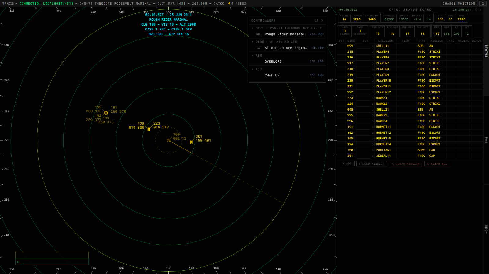
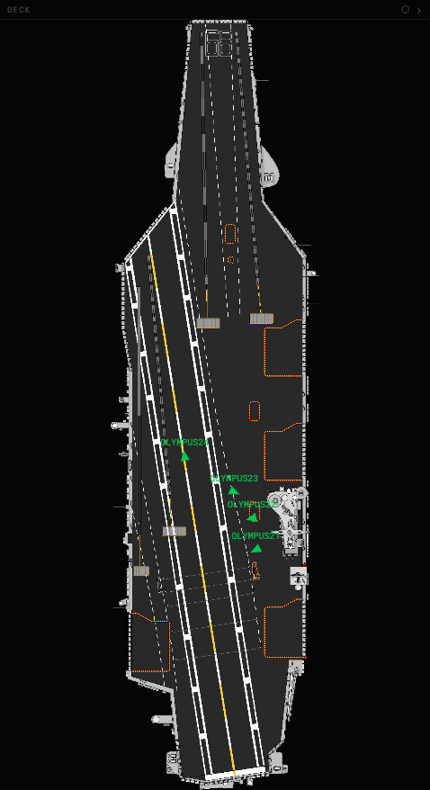

# CATCC (Carrier Air Traffic Control Center)

[← All docs](index.md)

Carrier air traffic control: a radar scope with a text command line, a synchronized Status Board, a PAR, and a Deck view for visual traffic on and around the carrier.

## Side numbers and correlation

A track's side number comes from the Status Board. TRACS matches each Status Board row to a live unit, either by the unit the row was created from (rows added with Ctrl+Click) or by callsign. What the datablock's first line shows depends on whether the unit is SRS-fielded (has reported SRS transponder data through a relay):

| Unit | Datablock line 1 |
|---|---|
| No SRS data, on the Status Board | The row's side number |
| No SRS data, not on the Status Board | `XXX` |
| SRS-fielded, not squawking | `XXX` |
| SRS-fielded, squawking the row's **BCN** code and flying the row's callsign | The row's side number |
| SRS-fielded, squawking but not matching a row | The live 4-digit squawk |

Line 2 is altitude and groundspeed. Only a track that shows a side number (a *correlated* track) can be taken under control with `IT`, `IC`, or Ctrl+Shift+Click. For SRS-fielded aircraft, that means entering the assigned code in the Status Board's BCN column. There's no command to assign a side number to a track directly.

## Emergency squawks

A track squawking 7400 (`LL`), 7500 (`HJ`), 7600 (`RF`), 7700 (`EM`) or 7777 (`MI`) shows that tag in red above its datablock. The tag flashes and a tone sounds for 5 seconds until you click the track (with an empty command line) to acknowledge it. After that the tag stays solid while the code is squawked. Line 1 is unchanged, so the tag never reveals a side number. Only SRS-fielded aircraft report a squawk, so AI aircraft never raise one. `.VOL` sets the tone's volume.

## Scope commands

Type into the command line, then press **Enter**, or click a target to complete a slew command (see below). Commands are case-insensitive; the scope uppercases as you type. Aircraft are addressed by side number or callsign.

`IC`, `TC`, `HO` and `MF` are entered with their keys (F3, F4, F5 and F7). Typing those letters doesn't enter the command, so `TC` + click sets a type of C (see [Status Board entry](#status-board-entry-from-the-command-line)).

| Command | Effect |
|---|---|
| `IT <callsign\|side>` | Initiate Track — claim ownership of a correlated, unowned contact |
| `DT <callsign\|side>` | Drop Track |
| `.DROPALL` | Drop every track you own |
| `HO` | Accept the first incoming handoff |
| `HO <callsign\|side> <tcp>` | Hand off to another controller position (`tcp` = their position id, e.g. `1D`) |
| `<side> <fields>` | Fill in the Status Board row with this side number, adding the row if there isn't one (see [Status Board entry](#status-board-entry-from-the-command-line)) |
| `RN <callsign\|side> [newCallsign]` | Rename a track's callsign, or omit the second argument to reset to default |
| `.HISTORY` / `.HIST` | Toggle history-trail display |
| `.LL [0-7]` | Set leader-line length (10 px per step); bare `.LL` queries the current value |
| `.LD [N\|NE\|E\|SE\|S\|SW\|W\|NW\|1-9\|OFF]` | Set the default leader-line direction; bare `.LD` or `.LD OFF` returns to NE |
| `.LABELSIZE [0-5]` | Set airspace/fix label size; bare `.LABELSIZE` queries the current value |
| `.DBSIZE [0-5]` | Set aircraft datablock size; bare `.DBSIZE` queries the current value |
| `.VOL [0-10]` | Set the alert tone volume (0 = mute); bare `.VOL` queries the current value |
| `.SBAUTOFILL` | Toggle Status Board ATD/ATA autofill for your position (off by default, remembered); see [Autofill](#status-board) |
| `.DBCA` | Toggle datablock collision avoidance (on by default): a track's own leader direction is always kept; every other datablock sits at the default leader direction unless that would overlap another datablock, cross another leader, or cover another track, in which case it moves to the nearest clear direction, and off the marshal radial |
| `.NOTE <text>` / `.NOTE* <text>` + click, `.NOTE` + click, `.NOTES` | Put a note on the scope, remove one, or remove all (see [Notes](getting-started.md#notes)) |
| `.METRIC` / `.IMPERIAL` | Set display units for the scope, status board and PAR (default imperial). Metric shows datablock altitude in hundreds of m, speeds in km/h and ranges in km |
| `.ASP` | Bulk-toggle all airspace categories |
| `.TMA` `.CTR` `.CTA` `.FIR` `.UIR` `.SUA` `.MIL` `.TRSA` `.CLASSA`–`.CLASSG` | Toggle one airspace category |
| `.LABELS` (aliases `.LBL`, `.LABEL`) | Toggle airspace/fix name labels |
| `.FILL` | Toggle airspace polygon fill; `.FILL <1-100>` sets transparency % and turns it on |
| `.FIXES` | Toggle theatre fix points |
| `.FIX <name...>` | Force-show one or more fixes regardless of `.FIXES`; each name toggles independently |
| `.FIX` (no argument) | Clear every pinned fix for the current theatre |
| `.GEO` | Toggle coastlines/boundaries |
| `.ASPCOLORS <name>` | Select an airspace color palette (e.g. `CATCC` — the default, all-yellow) |
| `.REFRESH` | Re-fetch airspace color palettes without reloading |

Errors appear in the ODS response area:
- `NO TRACK: <id>` — unit not found.
- `ILL TRK` — the track isn't yours to drop or hand off, or you tried to take control of a track that is uncorrelated or already owned.
- `ILL POS` / `ILL POS: <tcp>` — invalid handoff target.

**Slew commands** (type the command, then left-click the target):

| Command | Effect |
|---|---|
| `IC` | Initiate control on the clicked contact (must be correlated and unowned) |
| `TC` | Terminate control |
| `HO <tcp>` / `<tcp>` (e.g. `1D`) | Hand off the clicked track to a position; on your own track with a handoff already pending, recall it instead. While your handoff is pending, the receiving position's letter replaces the space between altitude and groundspeed (`050A220` for a handoff to `1A`) |
| `MF L<n><n>` (e.g. `MF L33`) | Set leader-line direction globally; `MF L<n>` sets it for the clicked track |
| `MF S`, then click anywhere on the scope | Relocate the status-text overlay |
| `<fields>` (anything that isn't one of the commands above) | Fill in the clicked aircraft's Status Board row (see [Status Board entry](#status-board-entry-from-the-command-line)) |

### Status Board entry from the command line

Fill in several Status Board fields at once, for example `101 7224 CHORNET21 PDENIM TF18C MSTRIKE B4.0 R150 D21 A6 E52 S5.5`.

- **`<side> <fields>` + Enter** updates the row with that side number, or adds one.
- **`<fields>` + click an aircraft** updates its row: the row for its correlated side number, else the row already linked to it (such as one added with Ctrl+Click), else a new row linked to it with its callsign. This form also takes a bare side number (`101 B4.0`) to set the row's side number.
- A side number is always 3 digits: type side 12 as `012`.

| Field | Sets |
|---|---|
| `<4 digits>` | BCN, including leading zeros (`0400`) |
| `C<callsign>` | Callsign (`CHORNET21` is `HORNET21`) |
| `P<pilot>` / `T<type>` / `M<mission>` | Pilot / type / mission |
| `B<bingo>` / `S<state>` | Bingo / state. A whole number is whole thousands: `B4` is 4.0 |
| `R<radial>` | Approach RAD |
| `D<dme>` / `A<angels>` | DME / Angels. One fills in the other like on the board. Both together stay linked if they agree, and are kept unlinked (yellow) if not |
| `E<eat>` | EAT: two digits for the next such minute, or four for an exact time |

Only the fields you type change, and a letter on its own clears its field (`101 E` clears the EAT). Fields can't contain spaces. If any field is invalid the whole line is rejected (`FORMAT: <field>`), as is a callsign or side number already on another row.

## Mouse & keyboard

| Gesture / Key | Effect |
|---|---|
| **Ctrl+Shift+Click** a contact | Initiate Control |
| **Shift+Click** a contact | Terminate Control |
| **Ctrl+Click** a contact | Add it to the Status Board |
| **Double-click** a contact | Show its Status Board details in the status overlay (correlated contacts only); again to drop them |
| **Click** a contact with a flashing emergency tag | Acknowledge it (empty command line only) |
| **Click** a contact with a pending handoff | Accept an incoming handoff, recall your own outgoing one, or stop the flash on a track the other position just accepted (empty command line only) |
| **Mouse wheel** over the scope | Zoom range, 1 NM per step (3 NM with Ctrl), 6–256 NM |
| Moving the mouse | Shows a live bearing/range readout from the carrier to the cursor. Over an aircraft correlated to a side number it adds that row's SIDE, callsign, TYPE, approach RAD (`R`, falling back to the header RAD), DME (`D`), ANG (`A`), EAT (`E`) and STATE (`S`), leaving out blank fields, and RAD and DME in CASE 1: `350/35 101 HORNET21 F18C R164 D21 A6 E52 S5.5` |
| **Ctrl+T** / **Alt+T** | Toggle top-down mode: also shows aircraft on the ground, such as aircraft on deck. Ctrl+T works in the desktop app only |
| **Ctrl+Alt+0**–**9** | Save current range to bookmark slot 0–9 |
| **Ctrl+0**–**9** | Load range bookmark 0–9 |
| `F3` / `F4` / `F5` / `F7` | Insert `IC` / `TC` / `HO ` / `MF ` into the command line. `F2`, `F6`, `F9`, and `F11` insert `TR `, `FD `, `FP `, and `CA `, which CATCC has no commands for |
| `Escape` / `Backspace` | Clears the command line (and drops the aircraft selected in the status overlay) / deletes the last character |

## Status Board

An event/recovery board shared by every CATCC position over the session's sync transport. Anyone can view and edit it.

**Header fields:**
- **Editable:** Event, Launch time and Recovery time (4-digit clocks), Ceiling, Visibility, QNH, Case (separate one-character Launch and Recovery fields), CV APP (a one-character approach field shown after Case Recovery in Case 2/3 only), the MAR/APP/TWR/DEP 2-digit radio button numbers, and RAD (radial). RAD is the marshal radial, used by the status overlay and the scope's radial line too. When Case Recovery is set to 2 or 3 and no RAD is set, it's fixed at the reciprocal of FB at that moment (green) and doesn't move as the carrier turns. Before that it shows the live reciprocal of FB. A typed RAD shows yellow; clearing it works it out again from the current FB.
- **Computed and read-only:** sunrise/sunset, magnetic variation, timezone, BRC, FB, and speed.

**Status overlay on the scope:** shows the time, your position, and recovery information that depends on the Case Recovery in effect. Double-click a row's green side number, or a correlated contact on the scope, to add that aircraft's details; double-click it again to drop them.

**Drift flash:** BRC and FB flash when they drift more than 5° from their baseline, and speed flashes when it drifts more than 5 kt. The flash stops once the value has held steady for 20 seconds.

In any open board field, **Delete** clears the whole field. A cleared RAD goes back to automatic; clearing DME or Angels clears the linked pair (or just that field, if the pair is unlinked).

**Aircraft table:** one row per aircraft.

| Column | Notes |
|---|---|
| EVT | Event |
| SIDE | Side number |
| BCN | Beacon/squawk code; ↻ recycles it |
| CALLSIGN | |
| PILOT | Auto-filled from the unit name if left blank |
| TYPE, MISSION | |
| ATD | Actual departure time |
| RAD | Departure radial |
| BINGO | Bingo fuel |
| SIDE (green) | Read-only copy of the side number; double-click it for a marshal slot (see below) |
| RAD | Approach radial, Case 2/3 only. Left blank it shows the header RAD (green); the marshal-slot double-click fixes it to the header RAD at that moment (green), so later header changes don't move the aircraft. A typed radial shows yellow. Type `E` for the emergency radial (FB + 150°), which turns the aircraft's whole row red, or `H` for the helicopter radial (FB + 110°, green); both are worked out once, when typed |
| DME | Case 2/3 only |
| ANG | Angels: altitude in thousands |
| EAT | Expected approach time |
| BTN | Radio button the aircraft is sent to. Left blank it follows the header TWR BTN (Case 1/2) or APP BTN (Case 3), shown green; a typed button shows yellow |
| STATE | Fuel state |
| ATA | Actual arrival time |

BCN and callsign together drive side-number correlation for SRS-fielded aircraft (see above).

**EAT entry:** the cell shows only the minutes. Type two digits for the next such minute at or after the current Zulu time (at 2055, `57` means 2057 and `01` means 2101), or four digits for an exact time. Sorting by EAT follows the full time, including across midnight.

**DME and ANG** are a linked pair, DME = ANG + 15. Typing either one fills in the other, for DME 21 / ANGELS 6 up to ANGELS 99. To set a nonstandard pair, prefix the value with `X` (for example `X21` in DME): the pair unlinks and keeps what you type. A value outside the linked range also unlinks it.

**Colours (Case 2/3):**
- **Green:** a linked DME/ANGELS pair, or an EAT filled in by the marshal-slot double-click.
- **Yellow:** an unlinked pair, or an EAT typed by hand.
- **Red:** a marshal-stack conflict. Aircraft that have landed (with an ATA) don't count. A conflict is any of:
  - two aircraft with the same EAT, or the same DME or ANG on one approach radial
  - two aircraft on one approach radial out of order, where the earlier EAT holds the higher altitude (both rows' EAT, DME and ANG turn red)
  - an EAT with no altitude where none fits between its neighbours
  
  Red overrides green and yellow.

**Adding entries:**

| Action | Effect |
|---|---|
| **+ Add** | Blank row |
| **Ctrl+Click** a contact on the scope | Adds it with callsign pre-filled |
| **⬆ Load Mission** | Import from a mission file (see below) |

**Editing:**
- Click a cell to edit it.
- `Tab`/`Shift+Tab` moves between fields, `Enter` commits, `Shift+Enter` commits and inserts a new blank row directly below, and `Escape` cancels without saving.
- Arrow keys move between table cells: Up/Down keep the column, and Left/Right move the text cursor and only jump to the neighbouring cell from the start or end of the text. A cell reached by arrow opens with its text selected, so typing replaces it. Arrows stop at the table's edges.
- Invalid time (`HHMM`, 0000–2359 or 2400) or fuel (`X.X`/`XX.X`) values are highlighted orange.
- STATE turns red when it's at or below BINGO.
- **Marshal slots (Case 2/3):** double-click a row's green (read-only) side number to give it the next EAT (one minute after the latest EAT in the stack) and an altitude. The altitude is the lowest free one on the row's approach radial (from Angels 6 / DME 21 up) that keeps that stack climbing: above every aircraft with an earlier EAT and below every aircraft with a later one. A row that already has an EAT keeps it and gets just the altitude; if no altitude fits between its neighbours it gets none, and its EAT shows red. Rows that already have DME or Angels are left alone. Aircraft with an ATA don't count. The first slot needs at least one EAT on the board to follow.
- **Right-click** a row's green side number for **Clear below this row**, **Clear above this row** or **Clear all** (as displayed, including any sort; the clicked row is kept). Each asks to confirm, then clears the approach side of those rows: approach RAD, DME, ANG, EAT, BTN, STATE and ATA. RAD and BTN fall back to the header values.
- **Right-click** a row's departure (yellow) side number for **Delete rows below**, **Delete rows above** or **Delete all rows**, with the same ordering and confirm. These remove the rows entirely.
- **Right-click** any other cell for **Clear column below** or **Clear column above**, with the same ordering and confirm. Each cell is cleared as Delete would clear it: a linked DME/ANG pair clears together, and RAD/BTN fall back to the header values.
- Click a column header to sort. This changes the display only and doesn't reorder the underlying data.

**Autofill (`.SBAUTOFILL`):** while on, ATD is stamped (Zulu) when an aircraft launches from your carrier and ATA when it traps. A trap counts once the aircraft has settled on deck at carrier speed for a few seconds, so a bolter or touch-and-go stamps nothing. A new launch overwrites ATD and clears the previous ATA. Aircraft first seen already parked on deck or already airborne aren't stamped, and going down an elevator to the hangar isn't a launch. The row is found the same way as for correlation: the row's own unit, or a matching callsign. The setting is per position, but the stamped times sync to everyone.

**Row controls:** ▲/▼ reorder, × deletes.

**Clearing:**
- **✕ Clear Mission** removes only rows imported from a mission file and blanks the weather fields. It's shown once mission data exists.
- **✕ Clear ALL** (two-step confirm) wipes everything and sets RAD back to automatic.

**Board scale:** mouse wheel over the title bar zooms the whole board 50–200%. Click the title-bar clock to toggle Zulu/Local time.

**Undocking:** the popped-out Status Board window's "dock" button closes the popup. The board's state stays in sync between the popup and the main window either way.

## Deck

A top-down carrier deck view for visual traffic near the boat.

- **Mouse wheel** — zoom (1x–4x; 1x is fit-to-panel)
- **Right-click + drag** — pan
- Aircraft near deck altitude and within the hull footprint are plotted as small triangles, labeled with side number or callsign, oriented to heading relative to the carrier
- Zoom resets when you switch carrier class

## PAR

The **PAR** tab (next to Status Board and Deck) opens a precision approach radar that starts in carrier mode on your signed-in carrier. It works the same as the ATC PAR; see [PAR](atc.md#par-precision-approach-radar).

## Mission Import

Opened from the Status Board's **⬆ Load Mission** button.

- Drop a `.miz` file or a raw mission text file onto the dropzone, or click to browse.
- The importer extracts:
  - **Weather** — QNH, visibility, and ceiling, with a note describing how the cloud preset was mapped to a ceiling.
  - **Carriers and their launching aircraft** — only aircraft whose first waypoint is a carrier departure (parking, hot start, or runway) count as launching from that carrier.
- A mission with no carriers fails with "No carrier ships found in this mission."
- If several carriers are found, pick one from the selector. The carrier matching your signed-in carrier is pre-selected. The list shows that carrier's launches, all pre-checked. Aircraft flown by a human (`Client` skill) are highlighted.
- Select which aircraft to import (checkboxes; the header checkbox selects all visible), then click **Import**.
  - Each imported row gets callsign, side number (from the modex), type, and mission. BCN is left blank.
  - Duplicate callsigns are skipped.
  - Weather is imported independently of the aircraft selection, and partial data (e.g. QNH only) is fine.
